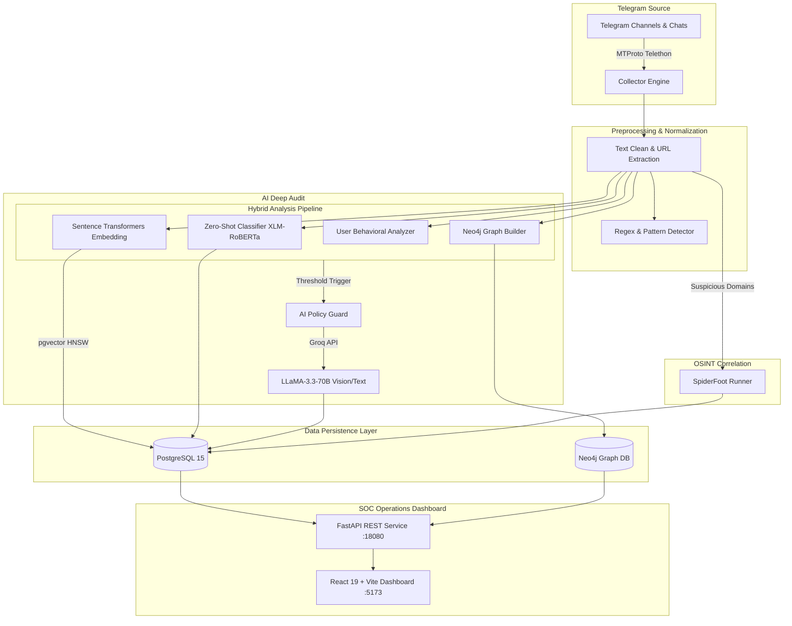

# 🛡️ PassiveAgent — AI & OSINT Telegram Threat Intelligence Platform

<p align="center">
  
</p>

<p align="center">
  <strong>Automated Real-Time Telegram Monitoring, AI-Powered Fraud Detection & OSINT Social Graph Intelligence</strong>
</p>

<p align="center">
  
  
  
  
  
  
  
  
</p>

---

## 📌 Обзор проекта / Project Overview

**PassiveAgent** — это комплексный аналитический комплекс и OSINT-платформа для пассивного мониторинга каналов и чатов Telegram в режиме реального времени. Система предназначена для выявления мошеннических схем (Scam), фишинговых кампаний (Phishing), спам-сетей, вредоносных URL и скоординированных бот-ферм.

Платформа сочетает классические методы OSINT, векторный семантический поиск, многофакторный скоринг рисков, графовый анализ связей (Graph Intelligence) и глубокий аудит подозрительных сообщений с помощью передовых языковых моделей (LLM via Groq).

---

## 🌟 Ключевые возможности / Core Features

### 📡 1. Real-Time Telegram Stream Ingestion
- Подключение через протокол MTProto (библиотека Telethon).
- Непрерывный асинхронный сбор сообщений, автоопределение типов контента (`text`, `link`, `image`, `video`, `voice`, `sticker`, `file`, `gif`).
- Извлечение метаданных отправителей, чатов и истории смены username/имен пользователей.

### 🧠 2. Многоуровневый аналитический конвейер (Hybrid AI Pipeline)
- **Zero-Shot NLP Классификация**: Многоязычная модель (XLM-RoBERTa / HuggingFace NLI) категоризирует сообщения по классам: `scam`, `phishing`, `spam`, `normal` (поддержка 100+ языков, включая RU, EN, UZ).
- **Векторные эмбеддинги и семантический поиск**: Модель `sentence-transformers` в связке с расширением `pgvector` в PostgreSQL для выявления кросс-канальных спам-рассылок и семантических дубликатов.
- **Детектор эвристических паттернов**: Извлечение криптокошельков, номеров карт, вредоносных доменов, призывов к быстрому заработку и психологических манипуляций.
- **Behavioral Scoring**: Анализ аномалий активности пользователя (частота сообщений, разнообразие каналов, процент ссылок).

### ⚡ 3. Deep AI Analysis (Groq LLaMA-3.3-70B)
- Политика адаптивного вызова LLM: автоматический триггер глубокой экспертизы только для сообщений, превышающих пороговый риск локального скоринга.
- Защита бюджетов: суточные и минутные лимиты токенов, дедупликация по тексту и кэширование результатов.
- Формирование структурированного вердикта: категория угрозы, уровень риска, обоснование, индикаторы компрометации (IoC).

### 🕸️ 4. Graph Intelligence (Neo4j)
- Построение графа взаимодействий: `(User)-[:POSTED_IN]->(Channel)`, `(User)-[:SENT_LINK]->(Link)`, `(Link)-[:FOUND_IN]->(Channel)`.
- Анализ топологии графа для выявления скоординированных сетей и кластеров ботов, распространяющих одинаковые ссылки.
- Расчет графового риск-фактора (Graph Risk Factor).

### 🕵️ 5. OSINT Интеграция со SpiderFoot
- Автоматический запуск подпроцессов SpiderFoot для глубокого сбора разведданных по доменам, хостам и IP-адресам, найденным в подозрительных ссылках.

### 🖥️ 6. Cyber Threat Intelligence Dashboard (React 19 + Vite)
- Интерактивный дашборд с темной темой в стиле SOC-центра.
- Живая лента сообщений с фильтрами по риск-уровню, категориям и статусу AI.
- Центр управления инцидентами (Alerts Triage) с возможностью резолва и добавления заметок аналитика.
- Профиль пользователя: таймлайн сообщений, история никнеймов, метрики риска.
- Семантический поиск похожих угроз и визуализация связей.

---

## 🏛️ Архитектура системы / Architecture



---

## 📂 Структура репозитория / Project Structure

```text
PassiveAgent/
├── .env.example             # Шаблон конфигурации переменных окружения
├── .gitignore               # Полная изоляция секретов, ключей, сессий и моделей
├── docker-compose.yml       # Стек БД: PostgreSQL + pgvector и Neo4j 5
├── install.bat              # Автоматическая установка виртуального окружения и npm-пакетов
├── start.bat                # Один клик для запуска БД, Backend API, Collector и Frontend
├── PROJECT_REPORT.md        # Детальный отчет о проектировании и этапах MVP
│
├── backend/                 # Ядро бэкенда на Python 3.12
│   ├── ai/                  # Groq клиент, AI-политики, промпты и схемы
│   ├── alerts/              # Менеджер оповещений и логика инцидентов
│   ├── analysis/            # ML-классификаторы, NLP, эмбеддинги, скоринг риска v2
│   ├── api/                 # FastAPI маршруты и контроллеры
│   ├── collector/           # Асинхронный Telethon слушатель сообщений
│   ├── config/              # Конфигурация Pydantic / dotenv
│   ├── graph/               # Neo4j Graph Builder и метрики графа
│   ├── processing/          # Нормализация текста и парсер ссылок
│   ├── spiderfoot/          # Встроенное OSINT-ядро SpiderFoot
│   ├── spiderfoot_service/  # Асинхронный раннер SpiderFoot сканирований
│   ├── storage/             # SQLAlchemy асинхронные модели и подключение к БД
│   ├── tests/               # Smoke-тесты API и AI модулей
│   ├── requirements.txt     # Python зависимости
│   └── main.py              # Точка входа (FastAPI + Collector + Vite)
│
└── frontend/                # Клиентский интерфейс (React 19 + Vite)
    ├── public/              # Статические ассеты (логотип, иконки)
    ├── src/
    │   ├── api/             # API клиент для взаимодействия с бэкендом
    │   ├── components/      # UI-компоненты (Alerts, Graph, Stats, Messages, Profile)
    │   ├── App.jsx          # Корневой компонент навигации
    │   └── index.css        # Современная Cyber-Dark стилизация
    ├── package.json
    └── vite.config.js
```

---

## 🛠️ Стек технологий / Technology Stack

| Направление | Технологии |
| :--- | :--- |
| **Backend & Core** | Python 3.12, FastAPI, Uvicorn, Telethon (MTProto), Pydantic, asyncio |
| **Machine Learning & NLP** | Hugging Face Transformers (`XLM-RoBERTa`), Sentence-Transformers (`all-MiniLM-L6-v2`), PyTorch |
| **Generative AI** | Groq Cloud SDK, Meta LLaMA 3.3 70B Versatile, Zero-Shot Prompt Engineering |
| **Databases** | PostgreSQL 15, `pgvector` (векторные индексы HNSW), Neo4j 5 (Graph DB / Cypher) |
| **OSINT** | SpiderFoot OSINT Automation Suite |
| **Frontend** | React 19, Vite 8, Modern CSS3 (Dark Glassmorphism, Micro-animations) |
| **DevOps & Containerization** | Docker, Docker Compose, Windows Batch automation |

---

## 🚀 Быстрый старт / Quick Start

### Требования:
- **Windows 10/11** (или Linux/macOS)
- **Python 3.12**
- **Node.js 20+ LTS**
- **Docker Desktop** (для PostgreSQL и Neo4j)

### 1. Клонирование репозитория
```bash
git clone https://github.com/magus24/PassiveAgent.git
cd PassiveAgent
```

### 2. Настройка переменных окружения
Скопируйте шаблон `.env.example` в `backend/.env`:
```bash
copy .env.example backend\.env
```
Откройте `backend/.env` и укажите свои параметры:
- `TELEGRAM_API_ID` и `TELEGRAM_API_HASH` (получить на [my.telegram.org](https://my.telegram.org))
- `GROQ_API_KEY` (бесплатный API ключ на [console.groq.com](https://console.groq.com))
- Учетные данные БД (по умолчанию совпадают с `docker-compose.yml`)

### 3. Автоматическая установка (Windows)
Запустите скрипт установки:
```cmd
install.bat
```
Скрипт создаст виртуальное окружение `backend/.venv`, обновит pip, установит Python-библиотеки и npm-зависимости во фронтенде.

### 4. Запуск проекта
Запустите платформу одной командой:
```cmd
start.bat
```
Скрипт автоматически:
1. Запустит контейнеры PostgreSQL (`pgvector`) и Neo4j в Docker Compose.
2. Проинициализирует таблицы базы данных и расширение вектора.
3. Поднимет FastAPI сервер (`http://localhost:18080`).
4. Запустит Telethon Telegram Collector.
5. Запустит Frontend Dashboard на Vite (`http://localhost:5173`).

---

## 🔒 Безопасность и конфиденциальность / Security & Privacy

Безопасность является фундаментальным приоритетом архитектуры PassiveAgent:

1. **Изоляция секретов**: Все токены (`GROQ_API_KEY`), хеши (`TELEGRAM_API_HASH`), пароли баз данных и сессии Telegram (`*.session`) жестко исключены из контроля версий через `.gitignore`.
2. **Безопасность Telegram**: Файлы MTProto-сессий Telethon хранятся исключительно локально и защищены от случайной публикации.
3. **Безопасность AI Pipeline**:
   - Персональные и чувствительные данные не отправляются во внешние LLM без предварительной локальной фильтрации.
   - Жесткие лимиты на частоту обращений (Rate Limiting) предотвращают исчерпание квот и финансовые риски.
4. **Контроль доступа**: Подготовлен шаблон переменных окружения `.env.example` без реальных секретов.

---

## 📊 Основные API Эндпоинты / REST API Endpoints

| Метод | Эндпоинт | Описание |
| :--- | :--- | :--- |
| `GET` | `/stats` | Сводная статистика сообщений, пользователей, алертов и распределения рисков |
| `GET` | `/messages` | Список перехваченных сообщений с фильтрацией по риску, категориям и AI статусу |
| `GET` | `/messages/{id}` | Полная карточка сообщения с NLP-результатами и вердиктом AI |
| `PATCH` | `/messages/{id}/review` | Обновление статуса ручной проверки аналитиком (confirmed, false_positive) |
| `GET` | `/alerts` | Список инцидентов с высоким риском |
| `PATCH` | `/alerts/{id}/resolve` | Закрытие инцидента с фиксацией резолюции |
| `GET` | `/similar?message_id={id}` | Векторный семантический поиск похожих сообщений через pgvector |
| `GET` | `/graph` | Экспорт узлов и ребер графа связей для визуализатора |
| `GET` | `/users` | Справочник профилей пользователей Telegram и история изменений имен |
| `GET` | `/user/{id}/analytics` | Аналитический профиль рисков конкретного пользователя |

---

## 👨‍💻 Автор и Портфолио / Author & Portfolio

Разработано как демонстрационный high-load проект в области **Cyber Threat Intelligence (CTI)**, **OSINT Automation** и **Applied AI / Machine Learning**.

- **GitHub**: [@magus24](https://github.com/magus24)
- **Технологический фокус**: Python, Highload FastAPI, Cyber Security, OSINT, ML/LLM pipelines, Full-Stack Architecture.

---

## 📄 Лицензия / License

Проект распространяется под лицензией [MIT License](LICENSE). Используется в исследовательских, демонстрационных и образовательных целях.
